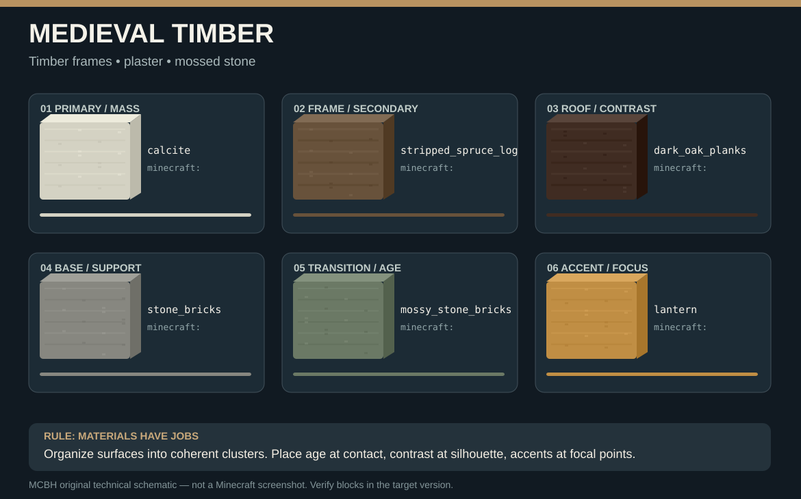

# MCBH — MinecraftBuildHumanized

**A real Model Context Protocol (MCP) server with an integrated professional Minecraft builder skill.** Create custom, human-informed voxel architecture: terrain-sensitive planning, block-palette reasoning, roof structure, layered facades, useful interiors and landscaping. MCBH is a tool for an AI **designer**, not a prefab house generator.

**Supported target:** Minecraft **Java Edition 1.21+** on **Vanilla, Fabric, Quilt, Forge and NeoForge dedicated servers** with the normal Java command system and RCON enabled. Bedrock Edition is different and not supported. **No client mod is required** for this transport. Does **not** connect to a standalone singleplayer client without a separately running RCON-capable Java server.

> Status: initial working MCP implementation. Command compiler, local persistence and pure-unit tests are included. Actual Minecraft server execution and MCP v2 integration have **not** been live-tested against all game versions/loaders. No one can guarantee universal compatibility with every third-party mod or future release without testing that exact server.

## Included

- MCP v2 **stdio** server, installable with `pip`, `uv` or `uvx`, with self-contained Python Source RCON transport.
- An actual building skill embedded in the install (`mcbh://skill`, `mcbh_read_skill`), with 15 chapters on architecture, roofs, palette logic, massing, terrain, interiors and scene composition.
- Curated reference URLs and palette resource catalogs (`mcbh://palettes`, `mcbh://references`). Reference images live on their owners' sites and are **not** copied or redistributed.
- Terrain-height sampling through Minecraft `execute positioned over` heightmaps using temporary marker entities; specific known-block predicate checks.
- Validated build plans with `set`, `box`, `line`, `polyline`, `ellipsoid`, and arbitrary `voxels`; optional block-state strings and replace filters.
- Exact world-command previews, material/command estimates, phased execution, explicit approval token, persisted progress and safe pause on errors.
- No arbitrary shell/server-command tool, no remote script download, no direct unrestricted NBT or entity spawning by a blueprint.
- An example multi-stage detailed cottage blueprint and a test suite.

## Visual apprenticeship: actual Minecraft screenshots and build diagrams

**[View the entire illustrated MCBH Visual Atlas](docs/VISUAL_ATLAS.md)**. It now includes real gameplay screenshots (hosted and credited to their original creators), seven architecture-specific visual block palettes and five original construction lessons. This is not just text URLs.





**Important:** SVG boards are original teaching diagrams, not in-game photos; the atlas embeds real screenshots separately. Image analysis requires an MCP host with vision/web support, and in-game visual audit requires screenshot access outside RCON. There is no claim that the plugin has literally observed images without that capability.

## Installation (Windows / PowerShell)

Install Python **3.11+** and [uv](https://docs.astral.sh/uv/):

```powershell
winget install --id astral-sh.uv -e
```

Enable RCON in your **Java dedicated server**'s `server.properties` and restart it:

```properties
enable-rcon=true
rcon.port=25575
rcon.password=choose-a-long-unique-secret
```

Keep port 25575 private and bound to localhost or a trusted private network; RCON is not encrypted. Make a full world backup before using building tools. Choose a nontrivial password. Then install from the GitHub repository:

```powershell
uv tool install "git+https://github.com/skaletun/MCBH.git"
$env:MCBH_RCON_HOST = "127.0.0.1"
$env:MCBH_RCON_PORT = "25575"
$env:MCBH_RCON_PASSWORD = "choose-a-long-unique-secret"
mcbh
```

`mcbh` is an MCP stdio process, so it does not display an interactive terminal UI. The MCP client normally starts it for you. To test with an MCP client, configure the following executable and environment. A client can use the uvx form without global install:

```json
{
  "mcpServers": {
    "MCBH": {
      "command": "uvx",
      "args": ["--from", "git+https://github.com/skaletun/MCBH.git", "mcbh"],
      "env": {
        "MCBH_RCON_HOST": "127.0.0.1",
        "MCBH_RCON_PORT": "25575",
        "MCBH_RCON_PASSWORD": "choose-a-long-unique-secret"
      }
    }
  }
}
```

This is a common `mcpServers` JSON shape (Claude Desktop and compatible clients). Other MCP hosts may use different configuration keys; use their docs. On systems where `uvx` is not in the GUI app's PATH, use its absolute path.

Linux/macOS:

```bash
python3 -m pip install "git+https://github.com/skaletun/MCBH.git"
export MCBH_RCON_HOST=127.0.0.1
export MCBH_RCON_PORT=25575
export MCBH_RCON_PASSWORD='choose-a-long-unique-secret'
mcbh
```

For source development:

```bash
git clone https://github.com/skaletun/MCBH.git
cd MCBH
python -m pip install -e '.[dev]'
pytest -q
```

## MCP tools

| Tool | What it actually does |
|---|---|
| `mcbh_connection` | Verifies authentication to the RCON server. |
| `mcbh_read_skill` | Reads full architectural skill or chapter. |
| `mcbh_palettes` | Curated stylistic/material palette rules. |
| `mcbh_references` | Source URLs: inspiration and technical docs. |
| `mcbh_visual_guides` | Credit-bearing real screenshot URLs and included construction/palette illustrations. |
| `mcbh_survey_terrain` | Non-block-edit heightmap samples from loaded chunks. |
| `mcbh_check_block` | Tests specific candidate block IDs at coordinates. |
| `mcbh_validate_blueprint` | Compile/check the plan without world changes. |
| `mcbh_stage_blueprint` | Persist complete plan; returns ID + approval token. |
| `mcbh_preview` | List exact commands, phase status, material estimate. |
| `mcbh_jobs` | Find prior local plans and progress. |
| `mcbh_execute_phase` | Execute a single approved phase in batches. |
| `mcbh_resume_reviewed` | Reopen a paused/uncertain job after inspection. |

MCP prompt: `professional_builder_task`. MCP resources: `mcbh://skill`, `mcbh://palettes`, `mcbh://references`, `mcbh://visuals`.

## Professional build workflow

1. Ask the AI: **“Use MCBH to design and build a unique timber inn on this hillside. Study the actual terrain, make a layered roof and facades, and fully furnish the interior. Show me the plan before modifying the world.”**
2. Agent reads skill and references, surveys terrain, creates a unique architectural concept and selects block palettes.
3. Agent creates complete absolute-coordinate geometry in ordered build phases, calls `mcbh_validate_blueprint` and `mcbh_stage_blueprint`.
4. Preview estimates **how many blocks are addressed**, what will be overwritten and which actual `/setblock`/`/fill` commands will execute. The agent obtains explicit human approval.
5. Agent runs `mcbh_execute_phase` repeatedly until phase completes; checks screenshots/in-game results between phases and fixes aesthetic or structural issues.

The repository's `examples/hill_cottage.json` demonstrates a complete staged blueprint intended for an empty test site near **X=200, Z=300**, with terrain preparation at approximately Y=69–70. **Do not run this against an existing build.**

## Blueprint JSON

Read `skill/SKILL.md` chapter **12. Coordinate blueprint schema**, plus the included example. Coordinates are absolute integers. Each operation has a full `minecraft:...` or mod namespace block-state string. A plan must include ordered named phases; the recommended phases are `site`, `foundation`, `structure`, `roof`, `facade`, `interior`, `landscape`, `lighting`.

The server will split normal large fills into safer 16,384-block tiles. Oversized `hollow`/`outline` are rejected because naive tiling corrupts the intended geometry. Shapes are compiled to actual vanilla setblock/fill commands; compression groups contiguous voxels.

## Important limitations

- **Art direction needs vision.** The server cannot obtain gameplay screenshots via RCON; actual visual audit requires the agent's vision/screenshot capability or user-supplied views.
- **No universal arbitrary block read.** Vanilla RCON supports conditional `execute if block` queries but not retrieving any non-block-entity block ID directly. Use supplied candidate IDs or a future optional read-only world bridge.
- **No reliable undo without a world backup.** Do not assume another program's block modifications can be restored. `mcbh_execute_phase` saves a command cursor but is not a world snapshot.
- **Version-dependent mechanics.** New 1.21.x releases can modify command syntax, blocks and gamerules. Third-party blocks need registry IDs and compatible block states from the actual modpack. Some structures (beds, doors, fluids, block entities) have placement logic and neighbor updates that need in-world verification.
- **Loaded chunks.** For builds/surveys, keep the target area loaded through a player, server view distance or controlled chunk tickets. MCBH does not silently force-load chunks.
- **Unsafe RCON exposure.** Do not publish port 25575 on the Internet. Use a secure tunnel and keep secrets out of version control.
- **Server output cannot guarantee success.** A command response can be localized or ambiguous. Visual and functional verification remain necessary.

## Research and attribution

Curated study sources include actual Planet Minecraft projects, WorldEdit official docs, Minecraft Wiki, official Minecraft release notes, and official MCP SDK docs. The JSON catalog stores URLs and notes, not ripped world files or copied images. Projects belong to their authors; respect licenses and attribution.

## License

MIT. Contributions welcome (see `CONTRIBUTING.md`).
