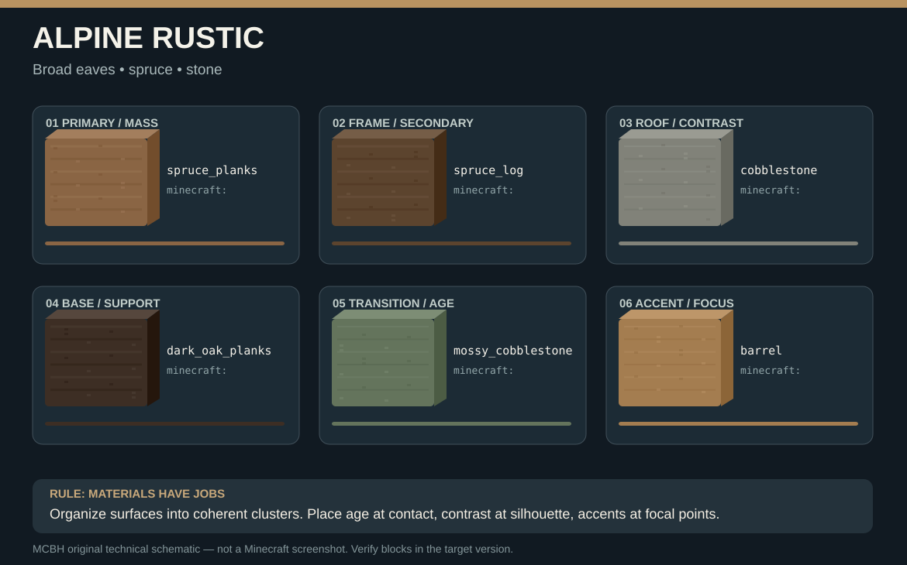
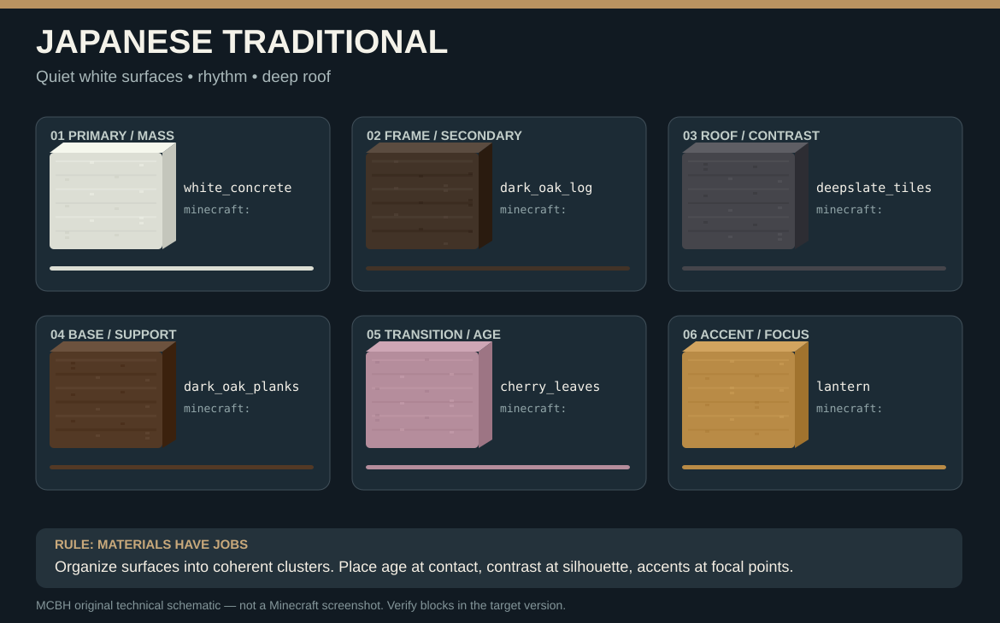
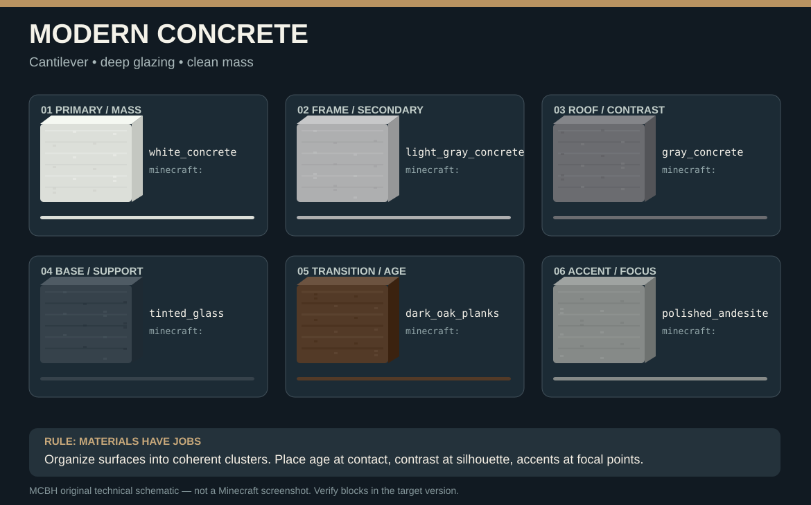
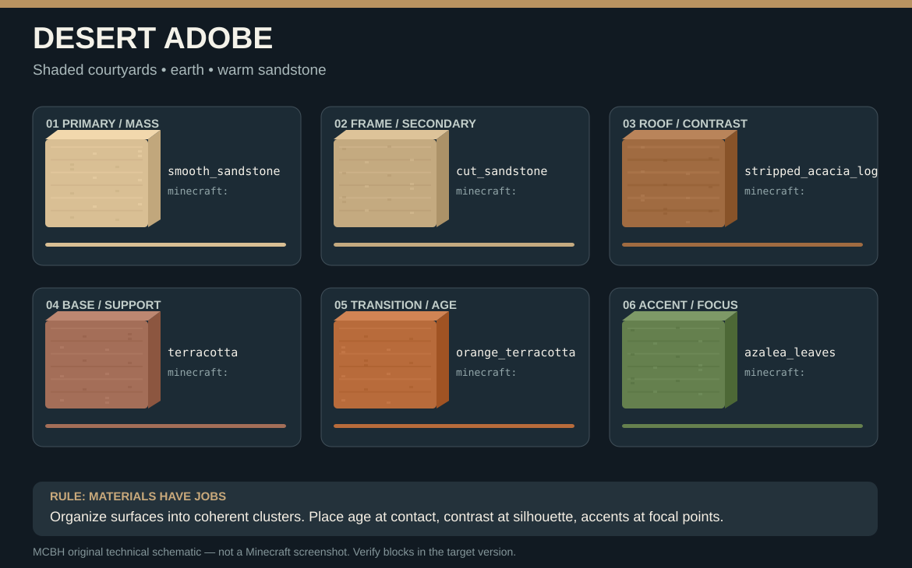
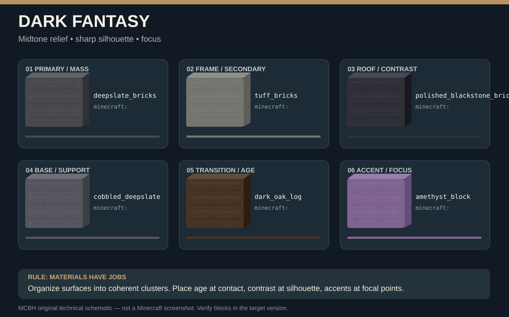
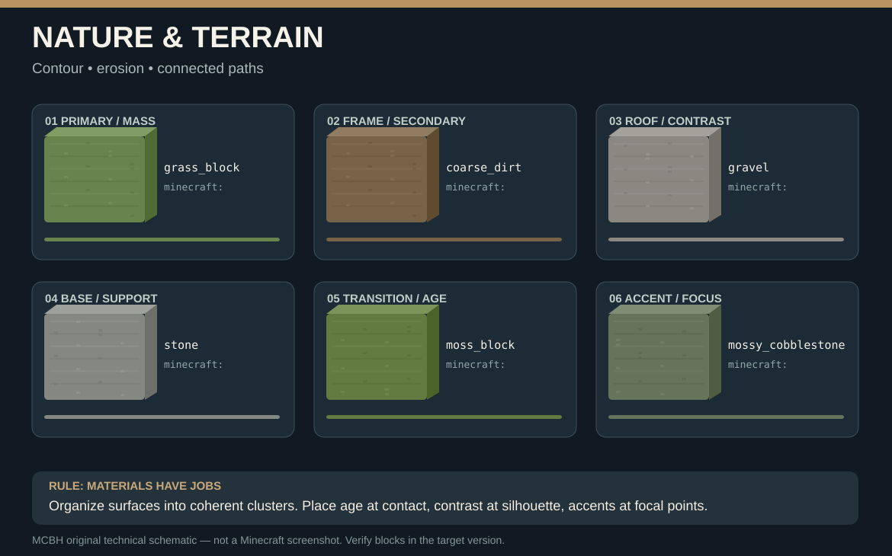
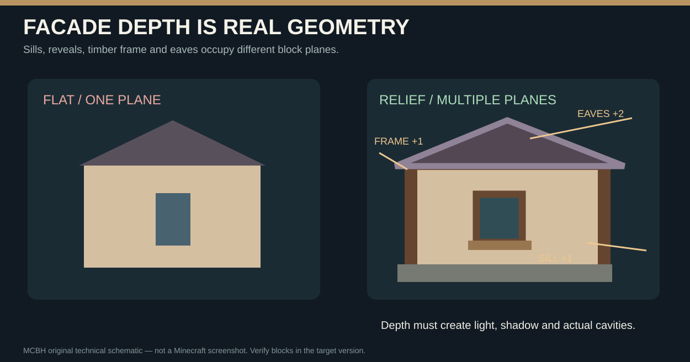
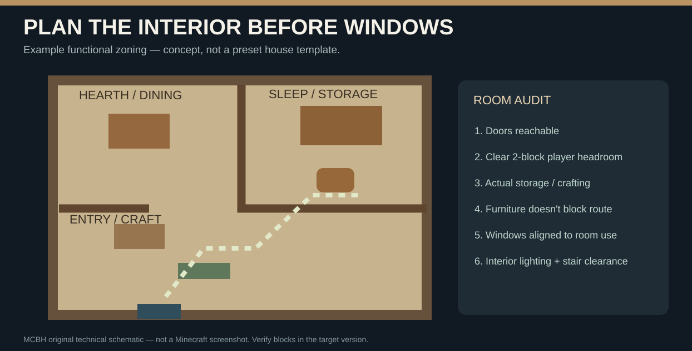
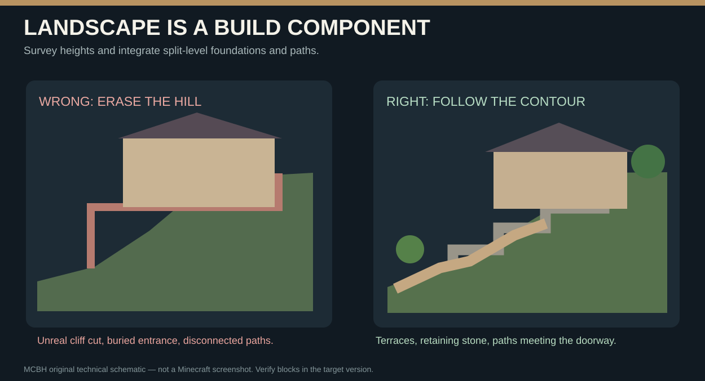

# MCBH visual apprenticeship atlas

> **Actual Minecraft screenshots + original instructional diagrams.** External screenshots below are embedded from their owners' sites and credited. MCBH's own SVG diagrams are educational illustrations **not gameplay screenshots**. Agents lacking image browsing must never claim to have visually examined the photographs.

## 1. How to build, step by step

Plan foundation, volumes, frame and roof *before* decoration. At every stage check actual 3D geometry, structural support and silhouette from all four directions.

### Real stone brick, carved and mossy material textures

**Source:** [Onenazo](https://onenazo.com/fr/blogs/learning-center/best-minecraft-building-blocks). **What the builder learns:** Use moss where damp, rough stone at contact and smoother stone on sheltered walls.

### Visual stone wall gradient tutorial

**Source:** [Minecraft Gradient](https://minecraftgradient.blog/minecraft-wall-gradient/). **What the builder learns:** Use directional gradients and coherent clusters, not random single-block mixing.

### Minecraft frame with actual columns and beams

**Source:** [Monster / MyFTB](https://forum.myftb.de/t/mittelklasse-haus-einsteiger-anleitung-fuer-mittelalter-haeuser/17862). **What the builder learns:** Frame precedes cladding. Structural bays align from base to eaves.

### Vanilla house construction frame

**Source:** [MineBox / utusemi0903](https://minebox.hateblo.jp/entry/2018/04/07/183400). **What the builder learns:** Offsets and support positions must be planned before closing walls.

### Actual Minecraft stairs-based roof building screenshot

**Source:** [Alucare](https://www.alucare.fr/es/comment-faire-un-toit-minecraft/). **What the builder learns:** Stair orientation, ridge continuity and eave depth must be resolved.

### Depth demonstration of cottage roof and walls

**Source:** [GraySun8151](https://x.com/GraySun8151). **What the builder learns:** Layer roofs and wall features; do not treat a building as a flat cube.

### 12th Century Northumbria medieval village

**Source:** [billoxiiboy](https://www.planetminecraft.com/project/medieval-project-ardacraft/). **What the builder learns:** Complex streetscape; special Conquest Reforged pack used by author, not vanilla.

### Medieval house with entire furnished interior project

**Source:** [Frost01](https://www.planetminecraft.com/project/extreme-detailed-medieval-house-full-interior/). **What the builder learns:** Interior must be functional; main screenshot alone cannot certify all rooms.

## 2. Professionally assembled palette boards

Vector palette blocks show **approximate colors** and purpose, not ripped Minecraft textures. Compare the screenshot above for actual stone texture. Validate block IDs against the target version and modpack.

### MEDIEVAL TIMBER

**Application:** Timber frames • plaster • mossed stone. Plan how these materials connect at corners, moisture zones and rooflines.

### ALPINE RUSTIC

**Application:** Broad eaves • spruce • stone. Plan how these materials connect at corners, moisture zones and rooflines.

### JAPANESE TRADITIONAL

**Application:** Quiet white surfaces • rhythm • deep roof. Plan how these materials connect at corners, moisture zones and rooflines.

### MODERN CONCRETE

**Application:** Cantilever • deep glazing • clean mass. Plan how these materials connect at corners, moisture zones and rooflines.

### DESERT ADOBE

**Application:** Shaded courtyards • earth • warm sandstone. Plan how these materials connect at corners, moisture zones and rooflines.

### DARK FANTASY

**Application:** Midtone relief • sharp silhouette • focus. Plan how these materials connect at corners, moisture zones and rooflines.

### NATURE & TERRAIN

**Application:** Contour • erosion • connected paths. Plan how these materials connect at corners, moisture zones and rooflines.

## 3. Detailed construction lessons

### Real depth rather than flat decoration

Timber projects one block from inset plaster; glass recedes behind posts; projecting sills and 1–2-block eaves cast shadows. Opening must be a cavity, not fake glass pasted on a wall.

### Roofs that are physically plausible

Use an actual staircase pitch, consistent block states and gable width; resolve ridge, valleys and intersecting sections. Don't let roof stairs float.

### Every room must be navigable

Design room purpose, doors, stairs, furniture placement, sunlight and safe lantern positions before calculating facade window geometry.

### Natural landscape adaptation

Survey slope height (4 corners, center, route), set step foundations, make retaining wall and stair paths. Never bulldoze a hill by default.

## 4. Mandatory agent reference-reading record

For every construction task pick (a) finished exterior screenshot; (b) real mid-construction screenshot; (c) role-based block palette illustration; (d) facade/roof construction plate; (e) interior and terrain plates. Record author, verified version/texture-pack restrictions, mass proportions, block-role hierarchy, plane offsets, roofing strategy, room circulation and terrain interface. Translate techniques into a **unique** geometry; do not plagiarize an existing build.

**Vision limitations:** RCON cannot return gameplay screenshots. MCP clients must support image URL viewing or accept actual screenshots from the user. If unavailable, report that visual QA remains pending; never pretend that image descriptions equal observed photos.

### Technical tutorials

- [Minecraft Wiki roof construction](https://minecraft.wiki/w/Tutorial:Roof_construction_guidelines)
- [Minecraft Wiki fill](https://minecraft.wiki/w/Commands/fill)
- [Minecraft Wiki execute / heightmaps](https://minecraft.wiki/w/Commands/execute)
- [MC Toolbox real block-texture palette picker](https://mctoolbox.net/minecraft-block-palette)
- [MyBlockBase material palette examples](https://www.myblockbase.com/tools/block-palette-generator)
